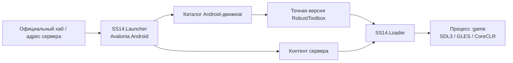

# Архитектура

## Исходники

| Часть | Расположение | Назначение |
| --- | --- | --- |
| SS14.Launcher | `upstream/SS14.Launcher` | XAML, ViewModel, авторизация, хаб, SQLite, контент и загрузчик |
| RobustToolbox | `engine/RobustToolbox` | Рендер, ввод, ресурсы, сеть, сериализация и sandbox |
| Android-host | `src/SS14.Android` | Activity, intents, native-зависимости, lifecycle |
| Адаптации | `patches/` | Изменения закреплённых upstream-исходников |
| Доставка | `scripts/`, `updates/`, `.github/workflows/` | Сборка, подпись и публикация |
| Диагностика | `tests/`, `probes/`, `src/RuntimeProbe.*` | Проверки кода и runtime |

Launcher закреплён на `18fa9830576023595bffb417b0eaeb929fee5934` (0.40.4), RobustToolbox — на `160be31f57129c24c1715b873b92f14d028de8b8`. Публикуемые движки собираются из собственных точных тегов: 294.0.1 — `cdf8d1258e8f9117b6a74fa80132143350250f16`. Базовый submodule включает последующую правку Windows packaging.

Контент сервера загружается штатным механизмом лаунчера и в APK не входит. Игра работает отдельно от лаунчера, чтобы при выходе освободить игровой runtime.

## Загрузка и обновления

| Слой | Доставка и проверка |
| --- | --- |
| APK | GitHub Releases; SHA-256, package ID, version code и прежний сертификат перед установщиком Android |
| Движок | Точная Android-сборка из HTTPS-каталога; SHA-256 и Ed25519 с закреплённым в APK ключом |
| Контент | Штатный механизм лаунчера выбранного сервера |

Каталоги хранятся в ветке `updates`, бинарники — в Releases. Официальные repair redirect заменяют отозванные версии разрешёнными. IL-verifier и sandbox сохранены, включая Debug; host предоставляет проверяющему PE-метаданные runtime.

Экспериментальный автопатч применяет подписанную бинарную дельту к известному официальному ZIP и получает точные байты подготовленного Android-пакета. Новые неизвестные версии по-прежнему требуют портирования и сборки.

## Ввод и интерфейс

SDL-синтез мыши из touch отключён: контроллер направляет одиночные касания в исходный InputManager после распознавания жеста. Окна, модальные диалоги и overlay не запускают жест камеры.

Обёртка `IEye` применяет увеличение 1–4 и поворот к рендеру и обратному преобразованию координат. Серверные EyeComponent, FOV и свет сохраняются; стик учитывает поворот.

Host передаёт через AppDomain снимок активных Android-указателей (`pointer ID + 1`, как в SDL). Проверка владельца стика по снимку предотвращает движение после потерянного SDL_UP. Отдельный callback предоставляет CPU/PSS/RAM открытой панели Debug. Старые host без callbacks сохраняют SDL-ввод, но не получают эту дополнительную проверку и Android-метрики.

Настройка `MobileUi` передаётся через `ROBUST_ANDROID_MOBILE_UI` в [адаптер мобильного интерфейса](mobile-ui.md), работающий с исходными виджетами сервера.

Лаунчер использует исходные Avalonia ViewModel и команды. Мобильная компоновка измеряется по доступному экрану; равномерное уменьшение остаётся запасным вариантом ниже 480×240. Строки серверов перестраиваются из исходных ячеек, списки сохраняют виртуализацию и собственную прокрутку.

Лобби, редактор и гайд адаптируются штатными `ScrollContainer`, `GridContainer`, `Button` и контейнерами Robust. Исходные виджеты перемещаются целиком; при отключении восстанавливаются родители, порядок и свойства компоновки. Content DLL не меняются.
