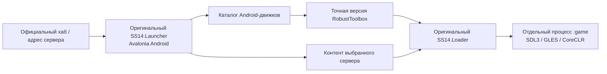

# Архитектура

## Исходники и границы адаптации

| Часть | Расположение | Назначение |
| --- | --- | --- |
| Оригинальный лаунчер | `upstream/SS14.Launcher` | XAML, ViewModel, вход, хаб, SQLite, контент и загрузчик |
| Оригинальный движок | `engine/RobustToolbox` | Рендер, ввод, ресурсы, сеть, сериализация и sandbox |
| Android-host | `src/SS14.Android` | Activity лаунчера и игры, intents, native-зависимости, lifecycle |
| Платформенные изменения | `patches/` | Воспроизводимые изменения закреплённых upstream-источников |
| Доставка версий | `scripts/`, `updates/`, `.github/workflows/` | Подготовка, сборка, проверка и публикация |
| Диагностика | `tests/`, `probes/`, `src/RuntimeProbe.*` | Проверки оригинального кода и возможностей runtime |

Launcher закреплён на `18fa9830576023595bffb417b0eaeb929fee5934` (0.40.4). RobustToolbox submodule — `160be31f57129c24c1715b873b92f14d028de8b8`. Публикуемые версии движков собираются по их собственным точным тегам; например, 294.0.1 — `cdf8d1258e8f9117b6a74fa80132143350250f16`. Разница с базовым submodule — последующая правка Windows packaging.

Игровой контент не входит в исходники интеграции или APK. Лаунчер получает его с выбранного сервера штатным механизмом. Отдельный игровой процесс позволяет завершать клиент и освобождать runtime, сохраняя лаунчер.

## Проверка загружаемого кода

APK закрепляет публичный Ed25519-ключ Android-движков. Установщик проверяет SHA-256 и подпись до загрузки, включая Debug. Оригинальные IL-проверка игровых модулей и sandbox сохраняются; APK предоставляет проверяющему PE-метаданные своего runtime.

Три независимых слоя обновления:

1. **APK:** Android-host и native-библиотеки. SHA-256, package ID, версия и сертификат проверяются перед штатным установщиком Android.
2. **Движок:** подготовленная Android-сборка точной upstream-версии; HTTPS-каталог, хеш и Ed25519-подпись.
3. **Контент:** оригинальный механизм лаунчера для выбранного сервера.

Ветка `updates` содержит каталоги. Файлы движков и APK размещаются в версионированных GitHub Releases. Официальный repair redirect может направить небезопасную старую версию на разрешённую замену; отозванный бинарник не запускается.

Экспериментальный «автопатч» применяет подписанную заранее подготовленную бинарную дельту к известному официальному ZIP. Получаются в точности подписанные байты Android-порта. Это не портирование произвольного нового движка на телефоне.

## Камера и сенсорный ввод

SDL-синтез мыши из touch отключён на Android: иначе клик возникает раньше распознавания второго пальца. Контроллер сам направляет одиночные касания в исходный InputManager. Касания окон, модальных диалогов и мобильного overlay не начинают жест камеры.

Локальная обёртка над `IEye` применяет увеличение и поворот к рендеру и обратному преобразованию координат. Серверный EyeComponent, FOV и свет не изменяются. Увеличение ограничено диапазоном 1–4 относительно обычного вида; движение стиком учитывает поворот камеры.

APK 0.7 передаёт через AppDomain снимок активных Android-указателей (`pointer ID + 1`, как в SDL). Игровой UI сверяет владельца стика с этим снимком после обработки событий; потерянное SDL_UP не оставляет движение включённым. Второй callback предоставляет CPU/PSS/RAM только по запросу открытой панели Debug. Старые host без этих необязательных callbacks сохраняют обычный SDL-ввод, но не получают дополнительную защиту и полную Android-телеметрию.

Мобильная компоновка чата и меню применяется в движке к настоящим виджетам загруженного сервера. Launcher preference `MobileUi` передаётся в игровой процесс через `ROBUST_ANDROID_MOBILE_UI`; выключение полностью исключает этот адаптер. Контракт, восстановление родителей и ограничения описаны в [mobile-ui.md](mobile-ui.md).
